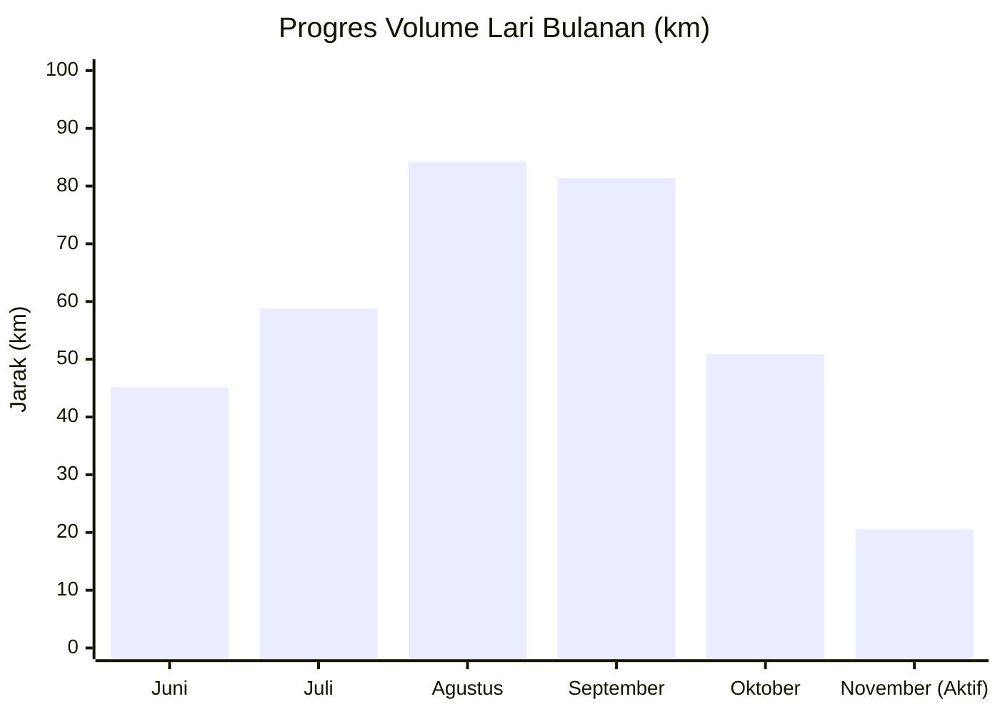

# Laporan Analisis & Evaluasi Latihan Lari Mendalam (Juni – November 2026)

Laporan ini disusun berdasarkan tinjauan historis dari **67 sesi lari (.fit files)** selama 5-6 bulan terakhir (5 Juni 2026 s/d 12 November 2026). Data mentah telah berhasil diekstrak dan disimpan dalam format CSV. Laporan ini bersifat evaluatif dan mendalam untuk merekam tren perkembangan fisiologis, biomekanik, serta pencapaian race Anda.

---

## 1. Ringkasan Eksekutif (Total Metrik Keseluruhan)

| Metrik | Nilai | Keterangan |
| :--- | :--- | :--- |
| **Total Sesi Lari** | **67 sesi** | Konsistensi latihan ~3–4 sesi per minggu |
| **Total Jarak Tempuh** | **341.02 km** | Sukses melampaui tonggak pencapaian 300 km! 🎉 |
| **Total Waktu Latihan** | **48 jam 19 menit** | Investasi latihan kardiovaskular kumulatif |
| **Total Kalori Terbakar** | **~29,860 kcal** | Rata-rata 445 kcal per sesi |
| **Rata-rata Jarak per Sesi** | **5.09 km** | Stabil di rentang jarak 4K – 10K |
| **Overall Weighted Pace** | **8:30 /km** | Pace rata-rata tertimbang seluruh jarak |
| **Rata-rata Detak Jantung** | **149.3 bpm** | Dominan di Zona Aerobik / Base |
| **Max Detak Jantung** | **187 bpm** | Dicapai pada sesi tempo intensif awal Juni |
| **Rata-rata Kadensi** | **148.2 spm** | Form langkah stabil dan ritmis |
| **Jarak Terjauh (Long Run)** | **17.09 km** | Edisi Kemerdekaan (17 Agustus 2026) |
| **5K Tercepat (Personal Best)** | **31:48 (Pace 6:20)** | 27 September 2026 (Race TMII) 🏆 |

---

## 2. Progres Bulanan (Volume, Intensitas, & Efisiensi)

Pertumbuhan performa dari bulan ke bulan menunjukkan tren adaptasi fisik yang progresif dan transisi menuju fase perlombaan serta pemulihan aktif:

| Bulan | Jumlah Sesi | Total Jarak (km) | Rerata Jarak (km) | Long Run Terpanjang | Rerata Pace | Rerata HR (bpm) | Efisiensi (EF)* | Rerata Kadensi (spm) |
| :--- | :---: | :---: | :---: | :---: | :---: | :---: | :---: | :---: |
| **Juni 2026** | 10 | 45.17 km | 4.52 km | 5.61 km | 9:36 /km | 148.7 bpm | 0.70 | 135.6 spm |
| **Juli 2026** | 11 | 58.81 km *(+30%)* | 5.35 km | 10.03 km | 8:42 /km | 150.9 bpm | 0.76 | 149.5 spm |
| **Agustus 2026**| 16 | 84.22 km *(+43%)* | 5.26 km | 17.09 km | 8:15 /km | 152.1 bpm | 0.81 | 150.6 spm |
| **September 2026**| 14 | 81.42 km | 5.82 km | 13.01 km | 7:57 /km | 150.3 bpm | 0.84 | 153.7 spm |
| **Oktober 2026**| 12 | 50.84 km | 4.24 km | 5.30 km | 8:19 /km | 143.8 bpm | 0.87 | 149.5 spm |
| **November 2026 (Aktif)**| 4 | 20.56 km | 5.14 km | 5.30 km | 8:42 /km | 148.2 bpm | 0.79 | 143.1 spm |

*\*EF (Efficiency Factor) = (Kecepatan m/menit) / Detak Jantung rata-rata. Semakin tinggi angka EF, semakin banyak jarak yang ditempuh per detak jantung (indikator kapasitas aerobik yang semakin prima).*

---

## 3. Analisis Fisiologis & Adaptasi Aerobik

> [!NOTE]
> **Kondisi Fisiologis Oktober – November: Puncak Efisiensi & Ketahanan Jantung**
> Pada 17 Oktober 2026, Anda mencatat performa lari cepat yang sangat efisien: **5.10 km** dalam **34:08 (Pace 6:41 /km)** dengan HR rata-rata hanya **159 bpm** dan kadensi tinggi **162.9 spm**, menghasilkan skor *Efficiency Factor* sebesar **0.940**.

Hal ini menunjukkan tiga pilar adaptasi kardiovaskular:
1. **Stroke Volume Jantung Terus Meningkat**: Jantung memompa volume darah beroksigen lebih banyak per detak pada pace tinggi.
2. **Kapasitas Aerobik Mencapai Efisiensi Tertinggi**: Skor rata-rata EF di bulan Oktober mencapai rekor **0.87**, didukung dominasi lari di zona aerobik santai.
3. **Pola Konsistensi Volume yang Stabil**: Memasuki November, Anda menjaga konsistensi jarak ~5.1 km per sesi dengan detak jantung terkontrol (148.2 bpm).

### Distribusi Zona Detak Jantung
- **Juni & Juli**: Menghabiskan 23% – 30% waktu di Zone 4 (Threshold) dan ~5% di Zone 5 karena tubuh masih beradaptasi dengan beban lari.
- **Agustus & September**: Fondasi aerobik terbentuk kuat, waktu di Zone 5 nyaris hilang (<1%) dan Zone 3 mendominasi.
- **Oktober & November**: Porsi **Zone 2 & Zone 3 mendominasi** (>65%), dengan waktu di Zone 4 ditekan ke level aman (~15-20%). Ini menunjukkan kebiasaan latihan yang semakin matang dan terhindar dari *overtraining*.

---

## 4. Analisis Teknik & Mekanika Lari (Kadensi / SPM)

- **Awal Latihan (Juni):** Rata-rata kadensi berada di **135.6 spm** (indikasi *overstriding* dengan beban benturan lebih berat ke sendi lutut).
- **Fase Pematangan (Agustus – September):** Rata-rata kadensi naik ke **150.6 – 153.7 spm**, dengan sesi lari cepat mencapai **161 – 164 spm**.
- **Oktober – November:** 
  - Pada sesi lari cepat (17 Oktober), kadensi konsisten tinggi di **162.9 spm**, mempertahankan langkah cepat dan lincah.
  - Pada sesi *easy run* dan *recovery*, kadensi rileks di kisaran 142–154 spm sesuai irama napas yang santai.

---

## 5. Milestone & Rekor Terbaik (Personal Bests)

### Lari Jarak Terjauh (Top Long Runs)
1. **17.09 km** | `02:39:37` | Pace 9:20 | HR 148 bpm *(17 Agustus 2026 - Spesial HUT RI)*
2. **13.01 km** | `01:51:40` | Pace 8:34 | HR 150 bpm *(13 September 2026)*
3. **10.03 km** | `01:27:16` | Pace 8:42 | HR 157 bpm *(23 Juli 2026 - Milestone 10K pertama)*
4. **8.25 km** | `01:00:41` | Pace 7:21 | HR 168 bpm *(29 Agustus 2026)*
5. **7.40 km** | `00:57:41` | Pace 7:47 | HR 154 bpm *(10 September 2026)*

### Sesi Lari Tercepat (Fastest 5K / Pace)
1. **5.01 km** – `31:48` (**Pace 6:20 /km**, HR 167, Cadence 164.0 spm) – *27 September 2026 (Race TMII)* 🏆 PB!
2. **5.04 km** – `33:33` (**Pace 6:39 /km**, HR 164, Cadence 161.6 spm) – *30 Agustus 2026*
3. **5.10 km** – `34:08` (**Pace 6:41 /km**, HR 159, Cadence 162.9 spm) – *17 Oktober 2026* 🥉 NEW TOP 3!
4. **5.14 km** – `34:42` (**Pace 6:45 /km**, HR 157, Cadence 162.9 spm) – *04 Oktober 2026 (KAI Commuter Run 5K)*
5. **5.15 km** – `36:53` (**Pace 7:09 /km**, HR 159, Cadence 158.1 spm) – *03 September 2026*

---

## 6. Pola Kebiasaan & Periodisasi Latihan

- **Waktu Latihan:**
  - **Sore Hari (15:00 – 18:00):** 41 sesi (61.2%) — waktu utama latihan harian sepulang aktivitas.
  - **Pagi Hari (05:00 – 11:00):** 18 sesi (26.9%) — waktu andalan untuk *long runs* dan sesi akhir pekan.
  - **Malam Hari (18:00 – 22:00):** 8 sesi (11.9%) — fleksibilitas latihan alternatif.
- **Konsistensi Jarak:**
  - Pada periode Oktober hingga pertengahan November, Anda mempertahankan jarak konsisten ~5 km per sesi (rata-rata 5.1 km), sangat ideal untuk menjaga *fitness level* tanpa risiko cedera.

---

## 7. Evaluasi & Rekomendasi Latihan Selanjutnya

> [!TIP]
> **Rekomendasi 1: Variasikan Volume dengan Kembali Menyelipkan Long Run**
> Di bulan Oktober dan November, hampir seluruh sesi berada di kisaran ~5 km. Untuk mempertahankan daya tahan aerobik jarak jauh (*endurance*), jadwalkan 1 sesi *Long Run* di akhir pekan secara bertahap (mulai 7–8 km lalu naik ke 10–12 km) dengan pace santai (Zone 2).

> [!TIP]
> **Rekomendasi 2: Latihan Interval / Tempo Mingguan**
> Keberhasilan menembus pace 6:41 pada 17 Oktober membuktikan kemampuan kecepatan Anda masih sangat terjaga. Pertahankan 1 sesi kualitas mingguan (misal: 4-5 repetisi 800m di pace 6:00 - 6:20 diselingi joging 2 menit) untuk melatih ambang laktat (*lactate threshold*).

> [!IMPORTANT]
> **Pencapaian: Milestone 300 KM Berhasil Ditembus!**
> Dengan akumulasi jarak saat ini sebesar **341.02 km**, Anda telah sukses melampaui rekor **300 km** total jarak tempuh sejak Juni 2026. Target berikutnya: **400 km**! Tetap konsisten dan jaga pemulihan dengan baik. 💪
