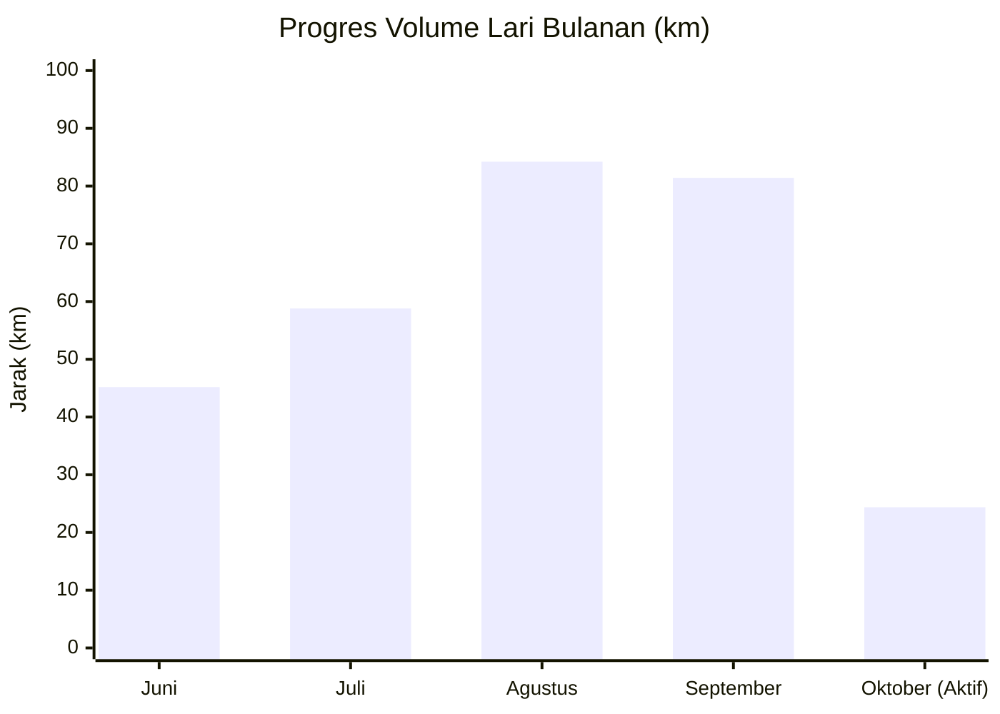

# Laporan Analisis & Evaluasi Latihan Lari Mendalam (Juni – Oktober 2026)

Laporan ini disusun berdasarkan tinjauan historis dari **57 sesi lari (.fit files)** selama 4-5 bulan terakhir (5 Juni 2026 s/d 11 Oktober 2026). Data mentah telah berhasil diekstrak dan disimpan dalam format CSV. Laporan ini bersifat evaluatif dan mendalam untuk merekam tren perkembangan fisiologis, biomekanik, serta pencapaian race Anda.

---

## 1. Ringkasan Eksekutif (Total Metrik Keseluruhan)

| Metrik | Nilai | Keterangan |
| :--- | :--- | :--- |
| **Total Sesi Lari** | **57 sesi** | Konsistensi latihan ~3–4 sesi per minggu |
| **Total Jarak Tempuh** | **293.99 km** | Mendekati tonggak pencapaian 300 km |
| **Total Waktu Latihan** | **41 jam 58 menit** | Investasi latihan kardiovaskular kumulatif |
| **Total Kalori Terbakar** | **~25,717 kcal** | Rata-rata 451 kcal per sesi |
| **Rata-rata Jarak per Sesi** | **5.16 km** | Stabil di rentang jarak 4K – 10K |
| **Overall Weighted Pace** | **8:34 /km** | Pace rata-rata tertimbang seluruh jarak |
| **Rata-rata Detak Jantung** | **149.1 bpm** | Dominan di Zona Aerobik / Base |
| **Max Detak Jantung** | **187 bpm** | Dicapai pada sesi tempo intensif awal Juni |
| **Rata-rata Kadensi** | **148.0 spm** | Form langkah stabil dan adaptif |
| **Jarak Terjauh (Long Run)** | **17.09 km** | Edisi Kemerdekaan (17 Agustus 2026) |
| **5K Tercepat (Personal Best)** | **31:48 (Pace 6:20)** | 27 September 2026 (Race TMII) 🏆 |

---

## 2. Progres Bulanan (Volume, Intensitas, & Efisiensi)

Pertumbuhan performa dari bulan ke bulan menunjukkan tren adaptasi fisik yang progresif dan transisi menuju fase perlombaan serta pemulihan aktif:

| Bulan | Jumlah Sesi | Total Jarak (km) | Rerata Jarak (km) | Long Run Terpanjang | Rerata Pace | Rerata HR (bpm) | Efisiensi (EF)* | Rerata Kadensi (spm) |
| :--- | :---: | :---: | :---: | :---: | :---: | :---: | :---: | :---: |
| **Juni 2026** | 10 | 45.17 km | 4.52 km | 5.61 km | 9:36 /km | 148.7 bpm | 0.70 | 135.6 spm |
| **Juli 2026** | 11 | 58.81 km *(+30%)* | 5.35 km | 10.03 km | 8:42 /km | 150.9 bpm | 0.76 | 149.5 spm |
| **Agustus 2026**| 16 | 84.22 km *(+43%)* | 5.26 km | 17.09 km | 8:15 /km | 152.1 bpm | 0.81 | 150.6 spm |
| **September 2026**| 14 | 81.42 km | 5.82 km | 13.01 km | 7:57 /km | 150.3 bpm | 0.84 | 153.7 spm |
| **Oktober 2026 (s/d 11 Okt)**| 6 | 24.37 km | 4.06 km | 5.14 km | 9:05 /km | 135.8 bpm | 0.86 | 145.8 spm |

*\*EF (Efficiency Factor) = (Kecepatan m/menit) / Detak Jantung rata-rata. Semakin tinggi angka EF, semakin banyak jarak yang ditempuh per detak jantung (indikator kapasitas aerobik yang semakin prima).*

---

## 3. Analisis Fisiologis & Adaptasi Aerobik

> [!NOTE]
> **Kondisi Fisiologis Oktober: Puncak Performa Race & Transisi Active Recovery**
> Pada 4 Oktober 2026 (KAI Commuter Run), Anda berhasil menyelesaikan **5.14 km** dengan waktu **34:42 (Pace 6:45 /km)** dengan detak jantung rata-rata hanya **157 bpm**. Sebagai perbandingan, saat menembus pace 6:39 di akhir Agustus, HR rata-rata berada di angka 164 bpm. Ini membuktikan jantung bekerja jauh lebih efisien pada kecepatan tinggi.

Hal ini menunjukkan tiga pilar adaptasi kardiovaskular:
1. **Stroke Volume Jantung Terus Meningkat**: Jantung memompa volume darah beroksigen lebih banyak per detak.
2. **Kapasitas Aerobik Meningkat (EF 0.86)**: Skor *Efficiency Factor* di bulan Oktober mencapai **0.86**, tertinggi di antara seluruh bulan latihan.
3. **Pola Pemulihan Aktif (*Active Recovery*) yang Sehat**: Pasca-race 4 Oktober, Anda menurunkan intensitas dengan cerdas (6, 8, 9, dan 11 Oktober), menjaga detak jantung bulanan Oktober di angka rata-rata **135.8 bpm**.

### Distribusi Zona Detak Jantung
- **Juni & Juli**: Menghabiskan 23% – 30% waktu di Zone 4 (Threshold) dan ~5% di Zone 5 karena tubuh masih beradaptasi dengan beban lari.
- **Agustus & September**: Fondasi aerobik terbentuk kuat, waktu di Zone 5 nyaris hilang (<1%) dan Zone 3 mendominasi.
- **Oktober (Fase Race & Recovery)**: Porsi **Zone 1 (25.2%)** dan **Zone 2 (29.2%)** melonjak drastis (total >54% waktu berada di zona nyaman/recovery). Ini adalah tanda periodisasi lari yang sangat baik pasca-lomba untuk meregenerasi jaringan otot tanpa kehilangan kebugaran.

---

## 4. Analisis Teknik & Mekanika Lari (Kadensi / SPM)

- **Awal Latihan (Juni):** Rata-rata kadensi berada di **135.6 spm** (indikasi *overstriding* dengan beban benturan lebih berat ke sendi lutut).
- **Fase Pematangan (Agustus – September):** Rata-rata kadensi naik ke **150.6 – 153.7 spm**, dengan sesi lari cepat mencapai **161 – 164 spm**.
- **Oktober (Race & Recovery):** 
  - Pada race 4 Oktober, kadensi Anda stabil tinggi di **162.9 spm**, memperlihatkan langkah kaki yang lincah dan ritmis di bawah tekanan kecepatan.
  - Pada sesi lari pemulihan santai (6 & 11 Oktober), kadensi disesuaikan secara alami tanpa memaksakan frekuensi tinggi.

---

## 5. Milestone & Rekor Terbaik (Personal Bests)

### Lari Jarak Terjauh (Top Long Runs)
1. **17.09 km** | `02:39:37` | Pace 9:20 | HR 148 bpm *(17 Agustus 2026 - Spesial HUT RI)*
2. **13.01 km** | `01:51:40` | Pace 8:34 | HR 150 bpm *(13 September 2026)*
3. **10.03 km** | `01:27:16` | Pace 8:42 | HR 157 bpm *(23 Juli 2026 - Milestone 10K pertama)*
4. **8.25 km** | `01:00:41` | Pace 7:21 | HR 168 bpm *(29 Agustus 2026)*
5. **7.40 km** | `00:57:41` | Pace 7:47 | HR 154 bpm *(10 September 2026)*

### Sesi Lari Tercepat (Fastest 5K / Pace)
1. **5.01 km** – `31:48` (**Pace 6:20 /km**, HR 167, Cadence 164.0 spm) – *27 September 2026 (Race TMII)* 🏆 PB!
2. **5.04 km** – `33:33` (**Pace 6:39 /km**, HR 164, Cadence 161.6 spm) – *30 Agustus 2026*
3. **5.14 km** – `34:42` (**Pace 6:45 /km**, HR 157, Cadence 162.9 spm) – *04 Oktober 2026 (KAI Commuter Run 5K)* 🥈 TOP 3!
4. **5.15 km** – `36:53` (**Pace 7:09 /km**, HR 159, Cadence 158.1 spm) – *03 September 2026*
5. **5.30 km** – `38:17` (**Pace 7:13 /km**, HR 156, Cadence 161.0 spm) – *22 September 2026*

---

## 6. Pola Kebiasaan & Periodisasi Latihan

- **Waktu Latihan:**
  - **Sore Hari (15:00 – 18:00):** 33 sesi (57.9%) — waktu utama latihan harian sepulang aktivitas.
  - **Pagi Hari (05:00 – 11:00):** 16 sesi (28.1%) — waktu andalan untuk *long runs* dan sesi *race day* akhir pekan.
  - **Malam Hari (18:00 – 22:00):** 8 sesi (14.0%) — fleksibilitas latihan alternatif.
- **Pola Pemulihan Pasca-Race:**
  - Setelah menyelesaikan KAI Commuter Run pada 4 Oktober, Anda mengambil jeda 1 hari dan melakukan *active recovery run* pada 6 Oktober (4.31 km, HR rendah 126 bpm).
  - Dilanjutkan dengan variasi lari pendek pada 8 & 9 Oktober (3–4 km) serta *recovery walk/run* pada 11 Oktober, menjaga sirkulasi darah tetap lancar tanpa risiko *overtraining*.

---

## 7. Evaluasi & Rekomendasi Menuju Target Berikutnya (PLN Electric Run 2026)

> [!TIP]
> **Rekomendasi 1: Membangun Kembali Aerobic Base Menuju 8 November**
> Race target Anda berikutnya adalah **PLN Electric Run 2026** (Minggu, 8 November 2026). Setelah masa recovery pasca KAI Run selesai di minggu ini, mulailah secara bertahap menaikkan kembali volume mingguan Anda dengan 2 sesi *Easy Run* (Zone 2, HR < 142 bpm) dan 1 sesi *Long Run* bertahap (mulai 8 km naik ke 10–12 km).

> [!TIP]
> **Rekomendasi 2: Latihan Spesifik Cadence & Pacing**
> Pada race 4 Oktober, Anda membuktikan mampu berlari di pace **6:45** dengan stabil dan HR terkontrol. Masukkan 1 sesi *Tempo Run* mingguan (3–4 km di pace target lomba 6:30 – 6:45) untuk mengasah *race feeling* Anda.

> [!IMPORTANT]
> **Rekomendasi 3: Menuju Milestone 300 KM Total Mileage**
> Dengan akumulasi jarak saat ini sebesar **293.99 km**, Anda hanya butuh **~6 km lagi** untuk menembus rekor **300 km** total jarak tempuh sejak Juni 2026. Ini adalah bukti konsistensi latihan yang luar biasa!
